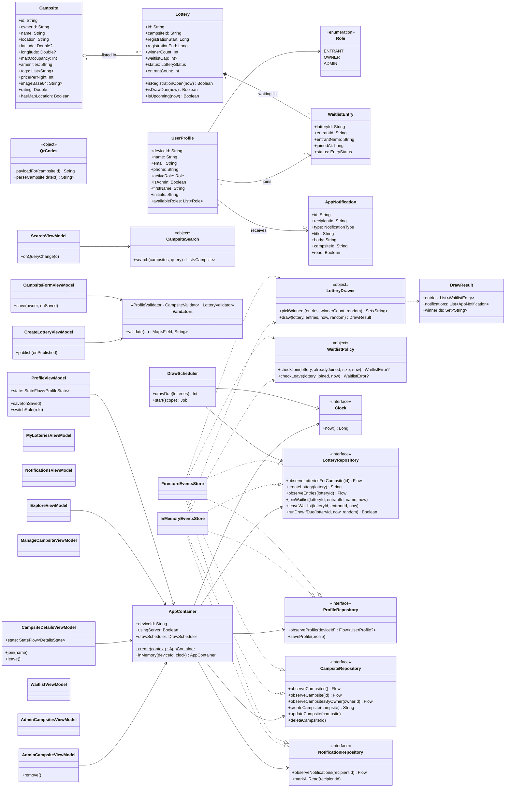

# Events: UML Class Diagram (half-way checkpoint)

GitHub renders the Mermaid diagram below directly in the wiki or README.
Layers: **model** (plain data) → **domain** (pure rules, unit-tested) → **data** (repository
interfaces with Firestore and in-memory implementations) → **ui** (MVVM view models and
Compose screens).

## Notes
- **Device identity (US 01.09.01):** `UserProfile.deviceId` is the Android ID and also the
  Firestore document ID, so no username or password exists.
- **Automatic draw (US 02.05.01):** `DrawScheduler` watches lotteries while the app runs.
  `runDrawIfDue` runs `LotteryDrawer` inside a Firestore transaction so exactly one device
  performs each draw and every entrant gets a win or loss `AppNotification`.
- **Testability:** domain objects are pure Kotlin; view models depend on `AppContainer`,
  which tests build with `InMemoryEventsStore` and a `FixedClock`.
